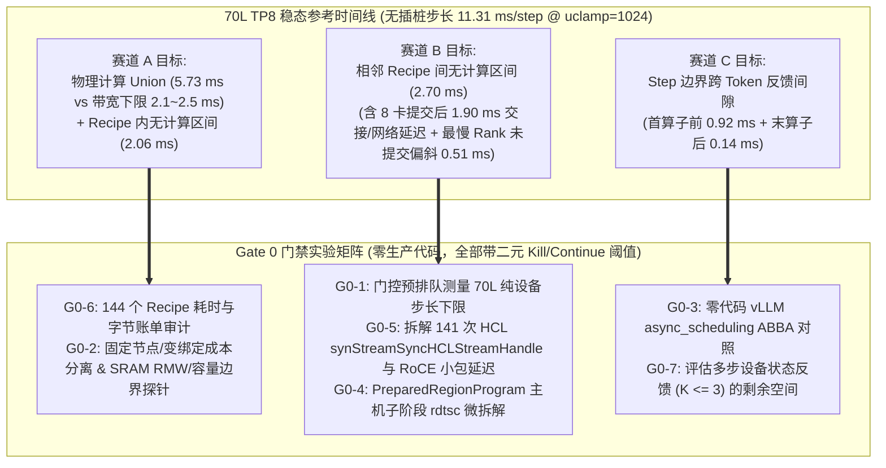

# GaudiRT 架构设计规范（Evidence-Driven Architecture & Gated Freeze Specification）

> **核心定位与防膨胀铁律（Anti-Bloat Mandate）**：
> 基于 [`software-autopsy.md`](file:///home/rate/llm/Gaudi-LLM/GaudiRT/docs/software-autopsy.md) 与三轮真机/反汇编/源码复核（归档清单见 [`GaudiRT/evidence/README.md`](file:///home/rate/llm/Gaudi-LLM/GaudiRT/evidence/README.md)）：
> 1. 70 层 TP8 模型在锁定高性能 CPU 策略（全线程 `uclamp = 1024`）下的无插桩基线为 **`11.31 ~ 11.32 ms/step`（`86.9 ~ 88.4 TPS`）**，主机提交（`5.18 ~ 5.40 ms`）已与设备执行跨度（`10.48 ms`）高度重叠；
> 2. 现有代码库已实现预绑定 `synLaunch` 区域执行器（[`NativeExecutionPlan.cpp`](file:///home/rate/llm/Gaudi-LLM/gaudi-pytorch-bridge/backend/habana_device/NativeExecutionPlan.cpp) 的 `PreparedRegionProgram`）、单份计划多步提交入口（[`BRIDGE-REPEATED-REPLAY-20261011.md`](file:///home/rate/llm/Gaudi-LLM/gaudi-kernels-public/docs/BRIDGE-REPEATED-REPLAY-20261011.md) 的 `graph.replay_many`）、C++ `synGraphHandle` + RMW SRAM 算子（[`gaudi-kernels-public`](file:///home/rate/llm/Gaudi-LLM/gaudi-kernels-public/csrc/ops/mxfp4_compact.cpp)）与固定槽位 Decode 输入缓冲（`MimoHPUWorker`）；
> 3. 静态反汇编已证实“在 `libSynapse.so` 外部绕开 `RecipeLauncher::launch` 的驻留实例（原 `L1_B`）”会破坏 Completion Group (`CG`) 计数器、卡死按 `LongSo` 回收的内部池或迫使手写未公开 ARC 调度包，**故在设计阶段直接砍掉 `L1_B`**。
>
> **因此，`GaudiRT` 绝不新建第三套运行时或执行器外壳。`GaudiRT` 仓库仅承载：Gate 0 硬件实测探针、证据账本、以及经门禁证明有确定性收益后直接合入 `gaudi-kernels-public` / `gaudi-pytorch-bridge` 的最小外科手术补丁。**

---

## 一、现有资产映射与设计裁决总表（什么已具备、什么已砍掉、什么待验证）

| 模块/方向 | 现有代码库资产或反汇编事实 | 架构裁决 |
| :--- | :--- | :--- |
| **预绑定 `synLaunchTensorInfoExt` + C++ 顺序循环 (`L1_A`)** | [`NativeExecutionPlan.cpp`](file:///home/rate/llm/Gaudi-LLM/gaudi-pytorch-bridge/backend/habana_device/NativeExecutionPlan.cpp) 中的 `PreparedRegionProgram` 已实现（144 计算 + 141 通信，`adapter_replays = 0`） | **直接复用**，严禁在 `GaudiRT` 中重写第二份循环执行器。 |
| **外部绕过 `RecipeLauncher` 的驻留实例 (`L1_B`)** | 反汇编（[`design-review-20261023/*.asm`](file:///home/rate/llm/Gaudi-LLM/GaudiRT/evidence/design-review-20261023/recipe-launch.asm)）证实外部跳过 `QueueComputeScal::launch` 会导致 `CG` 完成计数失步、内部池轮转受阻或必须手写私有 ARC 包 | **直接砍掉（Killed at Design）**，不写任何耦合 `libSynapse.so` 私有偏移或手写 ARC 包的代码。 |
| **Bridge 绑定预检微优化 (`98 ~ 127 µs`)** | [`CPU-DEPENDENCY-AND-OVERLAP-20261011.md:34`](file:///home/rate/llm/Gaudi-LLM/gaudi-kernels-public/docs/CPU-DEPENDENCY-AND-OVERLAP-20261011.md#L34) 已测得全步 Retained 绑定检查仅 `0.098 ~ 0.127 ms`（低于 `0.15 ms` 立项门槛） | **默认不做独立优化**（仅当 `G0-4` 在无 Profiler 下发现高于 `0.15 ms` 的主机子阶段时才处理）。 |
| **C++ `synGraphHandle` + RMW SRAM 算子构建 (`L2`)** | [`gaudi-kernels-public/csrc/ops/`](file:///home/rate/llm/Gaudi-LLM/gaudi-kernels-public/csrc/ops/mxfp4_compact.cpp) 已具备 `bf16_linear` / `fp8_linear` / `mxfp4_linear` / `mxfp4_compact` | **复用现有算子库**；是否重构特定算子完全取决于 `G0-6` 对 144 个 Recipe 的耗时/字节审计结果。 |
| **单步计划重复提交与有界设备状态反馈原型** | [`BOUNDED-DEVICE-FEEDBACK-20261011.md`](file:///home/rate/llm/Gaudi-LLM/gaudi-kernels-public/docs/BOUNDED-DEVICE-FEEDBACK-20261011.md)、[`BOUNDED-CAPACITY-20261011.md`](file:///home/rate/llm/Gaudi-LLM/gaudi-kernels-public/docs/BOUNDED-CAPACITY-20261011.md)、[`BRIDGE-REPEATED-REPLAY-20261011.md`](file:///home/rate/llm/Gaudi-LLM/gaudi-kernels-public/docs/BRIDGE-REPEATED-REPLAY-20261011.md) 已实现 `graph.replay_many(N)` 并验证 8 卡 $\le 3$ 步预排通过 | **复用 `replay_many` 基础**；先测零代码的 vLLM `async_scheduling`（`G0-3`），再决定是否推进模型级 $\le 3$ 步设备状态反馈（`G0-7`）。 |

---

## 二、三大真实攻关赛道（严格对齐去重后的设备时间线）



---

## 三、Gate 0：瓶颈定位与候选筛选实验矩阵（零生产代码）

所有 Gate 0 实验在 `192.168.100.153`（系统 SDK `1.24.2-481`）上执行，产物统一归档至 `GaudiRT/evidence/gate0-20261023/`。
**方法学三原则**：
1. **同起止边界对比**：不能拿不同生命周期边界（如“含输入准备/结果反馈的完整 TPOT”减去“纯设备跨度”）或不同流水重叠形态的差额直接砍掉某条路线；普通提交与预排队必须使用**相同起止事件**比较，完整 TPOT 另外测量；Gate 0 差值用于定位和排序候选瓶颈，某项优化最终是否保留由改动后的整模 ABBA 对照决定。
2. **核验实际执行路径**：由于现有代码（[`decode_graph.py:69`](file:///home/rate/llm/Gaudi-LLM/gaudi-kernels-public/python/gaudi_kernels/serving/decode_graph.py#L69)）在开启 `async` 后会退出完整 step graph 路径并停用部分输入缓存，任何对照实验必须先记录各臂实际命中的路径（`step_graph` / `prepared_region_replays`），绝不用“因退出快路径导致的变慢”去否决异步提交或设备端反馈机制。
3. **真模型逐级验证容量与闭环**：小图测出的 `571~573` 阻塞点不等价于真实模型 144 个大 Recipe 的在途容量；多步预排队与设备反馈必须在真实模型上按 **1 步 $\rightarrow$ 2 步 $\rightarrow$ 3 步** 逐级验证，同时检查 `token`、`position`、`KV` 与 `EOS` 闭环。

| 实验编号 | 实验名称 | 实验方法与同边界测量口径 | 瓶颈判定与优先级指导 |
| :--- | :--- | :--- | :--- |
| **`G0-8`**<br/>*(强制前提)* | **CPU 策略与 NUMA 亲和性锁定** | 所有单卡、双卡与 8 卡实验统一开启全线程 `uclamp = 1024`（`host_policy_enabled = true`）并绑定对应 PCIe/NUMA 物理核，在输出 JSON 中记录核验结果。 | **前置必须满足**：未锁定 `uclamp = 1024` 的计时一律无效。 |
| **`G0-9`**<br/>*(强制前提)* | **无插桩 ABBA 计时与 Profiler 隔离** | 端到端步长、TPS 与 API 耗时必须在**不加载 `libfeedback_observer_v2.so` 且不开启 SDK/CPU Trace Profiler** 的条件下按 `A -> B -> B -> A` 采集；如需硬件事件或 Trace 拆解，必须在无插桩计时完成后单独运行。 | **前置必须满足**：严禁把带 Profiler 的耗时直接当成无插桩步长。 |
| **`G0-1`**<br/>*(同边界设备跨度)* | **70 层 TP8 普通提交 vs 预排队同起止边界对比** | 对完整一步（`144 compute + 141 collective`）对比两种模式：<br/>• **普通提交**：正常边提交边执行；<br/>• **门控预排队**：流头部先放设备 Gate，将整步排完后再释放 Gate。<br/>• **严格同边界测量**：两组均在**同一个 `[first_op_start, last_op_end]` 边界**放置 `EVENT_COLLECT_TIME` 的 `synEvent` 测量设备执行跨度，并单独记录完整端到端 TPOT。 | • 同边界跨度差 $\Delta_{\text{span}} = T_{\text{span\_normal}} - T_{\text{span\_prequeued}}$ 直接反映**单步内因主机发令不够快导致的设备等待**；<br/>• 完整 TPOT 与 $T_{\text{span\_normal}}$ 的差额则反映**跨步输入准备、采样回读与首尾交接开销**，指导赛道 B/C 的优先级。 |
| **`G0-2`** | **Launch 成本解耦与 SRAM RMW 容量边界探针** | 纯 C++ 单卡探针，补齐两项基础物理参数：<br/>1. **解耦绑定数与节点数**：固定 `1` 个 TPC 节点，分别测 `3, 8, 16, 32` 个绑定张量；固定 `24` 个绑定，分别测 `1, 4, 8` 个节点，分离出真实的 `µs/binding` 与 `µs/node`；<br/>2. **SRAM `RMW=false` 对照与容量上限**：在 [`sram_mme_probe.cpp`](file:///home/rate/llm/Gaudi-LLM/GaudiRT/evidence/review-20261023/sram_mme_probe.cpp) 上对比 `RMW=false` vs `RMW=true`，并按 `2 KB -> 256 KB -> 2 MB -> 8 MB -> 16 MB -> 24 MB` 递增张量大小，导出 `post.json` 查明 `allocation == "SRAM"` 的实际容量上限及 `GCFG_RMW_SECTION_MAX_SIZE_BYTES` 行为。 | • 产出无混杂的 Launch 成本公式与编译器 SRAM 分配边界表，作为算子融合设计的客观依据。 |
| **`G0-3`** | **vLLM `async_scheduling` 路径核验与对照** | 在 70 层 TP8 模型上检查 `async_scheduling = False` 与 `True` 各自实际命中的执行路径（核实 [`decode_graph.py:69`](file:///home/rate/llm/Gaudi-LLM/gaudi-kernels-public/python/gaudi_kernels/serving/decode_graph.py#L69) 是否因 `async` 退出了完整 step graph 及输入缓存），测量两组净性能并记录路径差异。 | • 明确当前 `async_scheduling` 开关的实际路径行为；<br/>• 若因退出 step graph 导致退化，将其定位为“需在保持 step graph / prepared plan 快路径前提下支持异步提交或设备反馈”，绝不据此否定异步/设备反馈路线。 |
| **`G0-4`** | **`PreparedRegionProgram::replay` 主机耗时 `rdtsc` 微拆解** | 在 `uclamp = 1024` 下，不使用符号拦截，仅在 `NativeExecutionPlan.cpp` 的 `PreparedRegionProgram::replay` 内部用 5 个轻量级 `rdtsc` 时间戳记录单步累计耗时：① Retained 绑定预检；② `Frame::instantiate` + `lock_addresses`；③ 区域进出 ~4 次事件同步；④ `144` 次 `synLaunch` 调用；⑤ `141` 次 `hccl` 调用。 | • 定位 Bridge 包装层在 `uclamp = 1024` 下的真实耗时分布，优先改进占比显著（如 `>= 0.15 ms/step`）或阻碍异步化的环节。 |
| **`G0-5`** | **`2.70 ms` 通信间隙与流同步交接候选剖析** | 针对相邻 Recipe 间 `2.702 ms` 间隙（其中 `1.900 ms` 在 8 卡通信调用返回后），编写 8 卡 C++ 探针（`1.24.2-481`, `uclamp = 1024`，消息大小对齐模型 Decode 的 `12 KB` = `[1, 6144]` BF16），在相同事件边界下对比：<br/>① 连续 141 次 `12 KB` 8 卡 `hcclAllReduce` / `hcclAllGather` 的纯通信跨度；<br/>② 141 次穿插 `Compute Recipe -> hcclAllReduce -> Compute Recipe`（含 `libhcl.so` 内部 `synStreamSyncHCLStreamHandle` / `EventNetwork`）的执行跨度；<br/>③ 不同通信粒度/次数下的缩放斜率（注：充分考虑穿插与连续模式的流水重叠差异，不把差额简单等同于纯同步税）。 | • 量化每减少 1 次集合通信可节省的真实设备时间，以及 Compute $\leftrightarrow$ HCL 流交接的优化空间，指导修改算子通信次数或 Bridge 流编排。 |
| **`G0-6`** | **144 个 Recipe 的耗时、内部气泡 (`2.06 ms`) 与字节 Roofline 审计** | 导出 70 层 TP8 模型单步 `144` 个计算 Recipe 的逐个设备耗时、内部无 TPC/MME 气泡时长、读写字节数与算子类型（特别是占权重读取 34% 的 BF16 `o_proj`、FP8 `qkv_proj`、以及 `mxfp4` MoE 的 `tpc_folded_scale_tail` / `tpc_vector` / `all_gather_fp32_local_sum`），计算每个 Recipe 的 `实际耗时 / 带宽 Roofline 下限` 比值。 | • 找出设备关键路径上**最贵的算子族**与**内部气泡最大的 Recipe**，作为修改 `gaudi-kernels-public` 的头号目标。 |
| **`G0-7`** | **真实模型 `1 -> 2 -> 3` 步逐级预排队容量与设备状态反馈验证** | 鉴于小图 `571~573` 上限不能替真模型打包票，在真实模型命令规模与资源占用下，从 **1 步 $\rightarrow$ 2 步 $\rightarrow$ 3 步** 逐级验证完整预排队容量（检查是否触发 `waitForCompletionCopy` 或其它池背压），并单独验证每步 `token`、`position`、`KV 更新` 与 `EOS` 的设备反馈闭环正确性。 | • 摸清真实 70 层模型在不触发主机长阻塞前提下的安全预排队步数上限，并实测多步反馈闭环相对单步同步的端到端净收益。 |

---

## 四、Gate 0 之后的阶段化实施准则（单项独立 ABBA 验收）

只有通过上述 Gate 0 二元门禁的改造项，才准许进入后续阶段，并遵循以下两条铁律：
1. **第一性原理与负结果敬畏**：
   * 针对 **阶段一（算子与 Recipe 内部气泡优化，对应 `G0-6`）**：充分尊重 Gaudi2 MME 不支持原生 FP4、MXFP4 必须在 24 个 TPC 上解码的硬件事实，以及 `gaudi-kernels-public` 此前在小 $M$ 下 `mxfp4_compact` v2/v3 被速度门拒绝的历史证据。任何算子改动（无论是针对 BF16 `o_proj`、MoE 归约融合、还是 RMW SRAM 子图切分）都必须以 `G0-6` 的实测瓶颈为依据，并在单算子与整模两级通过速度门。
2. **单项独立 ABBA 归因（拒绝打包验收）**：
   * 在 **阶段一（Kernels/Recipes）** 与 **阶段二（Bridge 通信/跨步调度，对应 `G0-3 / G0-4 / G0-5 / G0-7`）** 中，**每一项具体改动必须单独执行 8 卡 70 层 TP8 无插桩 ABBA 对照**（锁定 `uclamp = 1024`，验证 768 个输出 Token 逐位一致），确认单项净收益达标后才准保留并叠加下一项，绝不将多项改动打包在同一个 `11.11 ms` 门槛下混同验收。

---

## 五、`GaudiRT` 仓库结构（仅存证据与独立探针）

```text
GaudiRT/
├── CMakeLists.txt                       # 极简 C++20 探针构建配置（链接系统 /usr/lib/habanalabs 1.24.2-481）
├── docs/
│   ├── software-autopsy.md              # 硬件参数、11.31ms 基线、573/571 阻塞栈、5.2GB 权重下限与现有栈审计
│   └── DESIGN.md                        # 本设计规范：资产映射、L1_B 砍线裁决、Gate 0 二元门禁矩阵
├── evidence/
│   ├── README.md                        # 各证据子目录来源、实验条件与关键文件索引
│   ├── review-20261023/                 # 第一轮真机复核（单算子 Launch ABBA、2KB SRAM->MME、70L 命令计数）
│   ├── runtime-audit-20261023/          # 第二轮历史预排队记录与库哈希核对
│   ├── design-review-20261023/          # libSynapse.so (1.24.2-481) 静态反汇编 (.asm) 与导出符号表
│   ├── review2-20261023/                # 第三轮 Module 7 纯 C++ 在途上限实测 (plain.log / gdb.log) 与两轮评审报告
│   └── gate0-20261023/                  # [下一步生成] Gate 0 (G0-1 ~ G0-7) 门禁实验原始日志与裁决 JSON
└── probes/                              # 独立、零框架依赖的 Gate 0 硬件探针
    └── prequeue_capacity_probe.cpp      # 已完成：定位 573/571 次 MappedMemMgr/waitForCompletionCopy 阻塞上限
```
