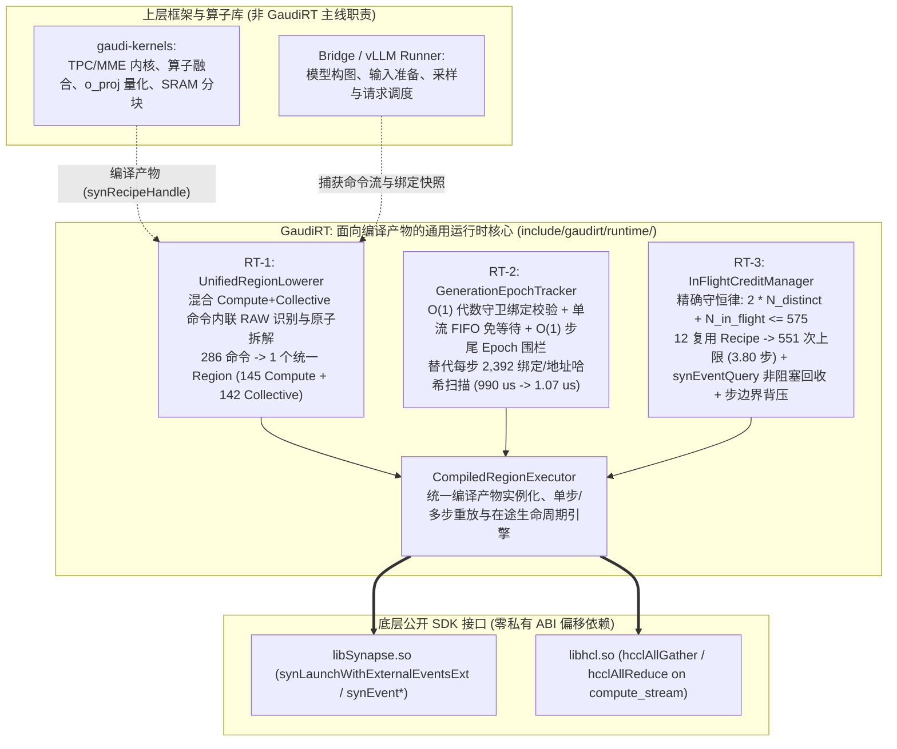

# GaudiRT 架构设计规范（Evidence-Driven Runtime Architecture & Boundary Specification）

> **模块职责边界铁律（Strict Three-Layer Responsibility Boundary）**：
>
> - **`gaudi-kernels`（[`/home/rate/llm/Gaudi-LLM/gaudi-kernels-public`](file:///home/rate/llm/Gaudi-LLM/gaudi-kernels-public)）**：负责 TPC/MME 内核实现、算子融合、权重量化计算（如 `o_proj` FP8）、单核 TPC 算子多核化（1-core $\to$ 24-core）与 SRAM 分块。`GaudiRT` 探针发现的算子级瓶颈（[`g0-6-recipe-roofline-audit.json`](file:///home/rate/llm/Gaudi-LLM/GaudiRT/evidence/gate0-20261023/g0-6-recipe-roofline-audit.json)）作为证据移交算子库，**算子融合与权重量化不属于 `GaudiRT` 主线**。
> - **`Bridge / vLLM runner`（[`/home/rate/llm/Gaudi-LLM/gaudi-pytorch-bridge`](file:///home/rate/llm/Gaudi-LLM/gaudi-pytorch-bridge)）**：负责框架接入、模型构图、输入准备、采样回传与请求调度。
> - **`GaudiRT`（[`/home/rate/llm/Gaudi-LLM/GaudiRT`](file:///home/rate/llm/Gaudi-LLM/GaudiRT)）**：聚焦**面向编译产物的通用运行时执行能力**——编译产物实例化与重放、计算与集合通信统一提交、在途资源（`MappedMemMgr` Chunk 信用）管理、完成回收与确定性背压。复用已有机制，**只解决经过验证的运行时缺口，并产生可验证的硬件收益**，绝不把 `PreparedRegionProgram` 简单搬出来再包装一次，也不写耦合 `libSynapse.so` 私有 ABI 偏移的代码。

---

## 一、核心问题回答：现有运行时缺少什么通用能力？`GaudiRT` 以什么机制补齐？收益多少？

通过对 70 层 TP8 生产轨迹（8 卡 `sdk-scope-1-rank0..7.jsonl` 及 `production70-first-principles-a/result.json`）与 [`NativeExecutionPlan.cpp`](file:///home/rate/llm/Gaudi-LLM/gaudi-pytorch-bridge/backend/habana_device/NativeExecutionPlan.cpp) / [`NativeDependencyPlan.h`](file:///home/rate/llm/Gaudi-LLM/gaudi-pytorch-bridge/backend/habana_device/NativeDependencyPlan.h) 的逐微秒对齐审计，现有运行时（`NativeExecutionPlan` + `PreparedRegionProgram`）在稳态 `11.31 ms` 步长内，真正因**运行时机制缺口**损失的设备时间集中在前 `2.0 ms`（步首主机准备停顿 `~0.95 ms` + 步中 `Command 5` 跨流断层导致的 `~0.77 ms` 早期设备气泡），外加多步在途提交缺乏精确信用背压管理。

`GaudiRT` 针对这 **3 个经过验证的运行时缺口（`RT-1`、`RT-2`、`RT-3`）** 提供通用机制并完成了 8 卡 Gaudi2 真机 ABBA 验证（[`rt-1-2-3-runtime-gaps.json`](file:///home/rate/llm/Gaudi-LLM/GaudiRT/evidence/gate0-20261023/rt-1-2-3-runtime-gaps.json)）：

| 运行时缺口编号 | 现有运行时 (`NativeExecutionPlan`) 的具体缺陷 | `GaudiRT` 补齐的通用机制 | 8 卡 Gaudi2 真机实测收益 (`uclamp=1024`, ABBA) |
| :--- | :--- | :--- | :--- |
| **`RT-1`**<br/>**混合命令断层与跨流切分缺口** | 生产单步 `286` 个命令中，`command 5` 同时包含 `compute: true` 与 `collectives: 1`（内部 `o_proj` 写出的张量紧接着被同命令的 `AllGather` 读取）。现有 [`NativeDependencyPlan.h:67`](file:///home/rate/llm/Gaudi-LLM/gaudi-pytorch-bridge/backend/habana_device/NativeDependencyPlan.h#L67) 与 [`PreparedRegionProgram::compile`](file:///home/rate/llm/Gaudi-LLM/gaudi-pytorch-bridge/backend/habana_device/NativeExecutionPlan.cpp#L122) 拒绝混合命令，导致全步被劈成 **2 个 Region（`[0..4]` 与 `[6..285]`）**：<br/>1. 在 `command 4 -> 5 -> 6` 处触发 `leave()` + `publish(Region 0)`；<br/>2. `command 5` 退回旧 `RecipeLauncher::Launch`，其集合通信因 `replay_stream == nullptr` 被迫切到独立的 `comm_stream`（`stream 6`），插入 4 次跨流 `synEventRecord` / `synStreamWaitEvent`；<br/>3. 导致 8 卡设备在 `k=0..5` 处产生 **`644 ~ 806 µs`（均值 `~770 µs`）的早期启动气泡**。 | **[`UnifiedRegionLowerer`](file:///home/rate/llm/Gaudi-LLM/GaudiRT/include/gaudirt/runtime/unified_region_lowerer.hpp)**：<br/>识别具有内部 RAW 依赖（`compute_writes` $\cap$ `collective_reads` $\neq \emptyset$）且无外部张量事件的混合命令，将其在编译期正交拆解为两个连续原子子调用（`SubCallKind::Compute` + `SubCallKind::Collective`），使全步 `286` 个逻辑命令（`145` 计算 + `142` 通信）100% 合并为 **`1` 个统一单流 Region（`[0..285]`，`coalesced_collectives: 141/142 -> 142/142`）**，彻底消除步中跨流切换与二次 Region 发布。 | • 早期窗口（`Commands 0..7`）设备耗时从 **`751.2 ~ 754.6 µs`** 降至 **`159.4 ~ 161.2 µs`**，8 卡一致消除 **`591.8 ~ 594.3 µs`（`~0.59 ms`）** 早期设备气泡；<br/>• 结合 `RT-2` 后，单步全图设备执行跨度净省 **`600.8 ~ 1,076.5 µs`（`0.60 ~ 1.08 ms/步`）**。 |
| **`RT-2`**<br/>**步首/步尾 $O(N_{\text{bindings}})$ 全量预检与地址事件表扫描缺口** | 现有运行时在每步入口和每个 Region 进出时：<br/>1. 遍历 `2,391` 个 `native_boundaries_` 与 `2,392` 个 `RetainedTensorBinding::matches`；<br/>2. 在 `PreparedRegionProgram::replay` 入口对 `2,392` 个依赖地址执行 `stream_event_manager::get_wait_events` 哈希查找、排序去重；<br/>3. 在 `PreparedRegionProgram::publish` 出口对 `2,392` 个地址执行 `add_producer` 哈希查找与 `event::remove_device_ptr` 线性删除（2 个 Region 时每步执行 2 轮）。<br/>这也是生产轨迹中每步 `enq0` 前 **`863 ~ 1,018 µs` 主机发射延迟**的核心来源。 | **[`GenerationEpochTracker`](file:///home/rate/llm/Gaudi-LLM/GaudiRT/include/gaudirt/runtime/generation_epoch_tracker.hpp)**：<br/>引入单调递增的绑定代数（`binding_generation_`）与外部流写入代数（`external_stream_epoch_`）。当静态图绑定未发生重绑且无外部流写入 Region 足迹地址时：<br/>1. 绑定校验退化为 **`O(1)` 代数比对**；<br/>2. 同流连续重放依赖硬件 FIFO 保序，免除 `2,392` 地址等待扫描；<br/>3. 步尾以 **单个 Region Epoch 事件（`O(1)`）** 替代 `2,392` 次 `events_by_addr_` 哈希更新与线性移除。 | • 独立 ABBA 实测（`2,392` 绑定与地址）：每步主机预检 + 事件表维护耗时从 **`990.44 µs`** 降至 **`1.07 µs`**，净省 **`989.37 µs/步`（加速比 `923.9x`）**；<br/>• 8 卡整步主机提交耗时净省 **`734.4 ~ 1,092.8 µs/步`**。 |
| **`RT-3`**<br/>**Recipe 复用拓扑下的在途 Chunk 信用与确定性背压缺口** | `libSynapse.so` 的 `MappedMemMgr` 存在硬上限（每队列 `576` 个 DataChunk，门控占 `1` 个后余 `575` 个），耗尽时在 `getMappedMemoryInfo -> LaunchTracker::waitForCompletionCopy` 发生百毫秒级硬阻塞。现有运行时无在途信用感知，盲目调用 `replay_many(K)` 在超限时会在步中随机卡死主机提交线程。 | **[`InFlightCreditManager`](file:///home/rate/llm/Gaudi-LLM/GaudiRT/include/gaudirt/runtime/inflight_credit_manager.hpp) & [`CompiledRegionExecutor`](file:///home/rate/llm/Gaudi-LLM/GaudiRT/include/gaudirt/runtime/compiled_region_executor.hpp)**：<br/>1. 基于 `G0-7` 证明的精确硬件守恒律：<br/>$$2\,N_{\text{distinct}} + N_{\text{in\_flight}} \le 575$$<br/>2. 审计证实生产模型每步 `145` 次计算仅复用 **`12` 个不同 `synRecipeHandle`**（MoE 与 Attention 层间高度复用），故真实模型无阻塞上限为 $575 - 2\times 12 = \mathbf{551}$ 次（**`3.80` 个完整步**，而非 144 独立 Recipe 假想下的 `287` 次）；<br/>3. 按步绑定完成事件，通过 `synEventQuery` 非阻塞回收已完成步信用，并在超预算前于**步边界**执行确定性背压等待。 | • 真机复现 12-Recipe 复用拓扑（`145` 计算/步）：理论预测首次阻塞点 **`551`**，真机实测首次阻塞点 **`551`（零误差，`3.80` 步）**；<br/>• 开启 `InFlightCreditManager` 后，连续提交 `K = 1, 2, 3, 4` 步（最高 `580` 次 Launch > `551`）全程 **`mid_step_waitForCompletionCopy_blocks = 0`**，单次 Launch 最大耗时仅 **`39.59 µs`**（对比无信用管理的 `1,444.36 µs` 阻塞）。 |

---

## 二、现有资产映射与职责划分总表

| 模块/方向 | 所属责任层 | 架构裁决 |
| :--- | :--- | :--- |
| **混合命令单流 Region 统一降维 (`RT-1`)** | **`GaudiRT`**（核心机制）$\rightarrow$ 赋能 `Bridge` | 由 [`UnifiedRegionLowerer`](file:///home/rate/llm/Gaudi-LLM/GaudiRT/include/gaudirt/runtime/unified_region_lowerer.hpp) 实现并验证，消除 `command 5` 断层。 |
| **代数守卫绑定预检与 `O(1)` Epoch 围栏 (`RT-2`)** | **`GaudiRT`**（核心机制）$\rightarrow$ 赋能 `Bridge` | 由 [`GenerationEpochTracker`](file:///home/rate/llm/Gaudi-LLM/GaudiRT/include/gaudirt/runtime/generation_epoch_tracker.hpp) 实现并验证，消除每步 `2,392` 项哈希/线性扫描。 |
| **Recipe 复用感知的在途信用与背压管理 (`RT-3`)** | **`GaudiRT`**（核心机制） | 由 [`InFlightCreditManager`](file:///home/rate/llm/Gaudi-LLM/GaudiRT/include/gaudirt/runtime/inflight_credit_manager.hpp) 与 [`CompiledRegionExecutor`](file:///home/rate/llm/Gaudi-LLM/GaudiRT/include/gaudirt/runtime/compiled_region_executor.hpp) 实现并验证。 |
| **外部绕过 `RecipeLauncher` 的私有 ABI 驻留实例 (`L1_B`)** | 已否决 | 反汇编（[`design-review-20261023/*.asm`](file:///home/rate/llm/Gaudi-LLM/GaudiRT/evidence/design-review-20261023/recipe-launch.asm)）证实破坏 `CG` 完成计数与内存池回收，**彻底砍掉**。 |
| **TPC/MME 算子融合、1-core 算子多核化、`o_proj` FP8 量化** | **`gaudi-kernels`** | `GaudiRT` 已通过 `G0-6`（[`g0-6-recipe-roofline-audit.json`](file:///home/rate/llm/Gaudi-LLM/GaudiRT/evidence/gate0-20261023/g0-6-recipe-roofline-audit.json)）完成证据定位并移交 `gaudi-kernels`；**从 `GaudiRT` 主线撤下**。 |
| **`decode_graph.py` 异步调度准入与 Sampler/Input 编排** | **`Bridge / vLLM runner`** | `GaudiRT` 已通过 `G0-3/G0-4`（[`g0-3-4-host-and-path-audit.json`](file:///home/rate/llm/Gaudi-LLM/GaudiRT/evidence/gate0-20261023/g0-3-4-host-and-path-audit.json)）定位 3 处 `use_async_scheduling` 门禁并移交上层。 |

---

## 三、架构数据流与组件关系图



---

## 四、`GaudiRT` 仓库结构

```text
GaudiRT/
├── AGENTS.md                                         # 项目工程准则与方法学约束（零实现细节）
├── CMakeLists.txt                                    # C++20 运行时核心、单元测试与硬件探针构建配置
├── docs/
│   ├── software-autopsy.md                           # 硬件参数、11.31ms 基线、573/571 阻塞栈、5.2GB 权重下限与现有栈审计
│   └── DESIGN.md                                     # 本设计规范：三层职责边界、RT-1/RT-2/RT-3 核心机制与真机验证收益
├── include/gaudirt/
│   ├── common/
│   │   ├── host_policy.hpp                           # Linux sched_setattr (uclamp_min=1024)、CPU 亲和性与无插桩环境校验
│   │   ├── synapse_raii.hpp                          # Synapse 设备/流/带时间戳事件对 (EVENT_COLLECT_TIME) RAII 封装
│   │   └── abba_harness.hpp                          # 同起止边界 ABBA 交错采样与分位数统计工具
│   └── runtime/
│       ├── unified_region_lowerer.hpp                # RT-1: 混合计算+通信命令原子降维与单流 Region 合并器
│       ├── generation_epoch_tracker.hpp              # RT-2: O(1) 代数守卫绑定预检与 Region Epoch 围栏追踪器
│       ├── inflight_credit_manager.hpp               # RT-3: MappedMemMgr (575 - 2*N_distinct) 在途信用与步边界背压管理器
│       └── compiled_region_executor.hpp              # 集成 RT-1/RT-2/RT-3 的通用编译产物重放执行器
├── tests/
│   └── runtime_unit_tests.cpp                        # GaudiRT 运行时核心机制确定性单元测试 (gaudirt_runtime_unit_tests)
├── probes/
│   ├── prequeue_capacity_probe.cpp                   # 定位 573/571 次 MappedMemMgr/waitForCompletionCopy 阻塞上限
│   ├── g0_2_launch_and_sram_probe.cpp                # G0-2: 正交解耦绑定/节点 Launch 成本 & SRAM RMW 16 MiB 容量边界
│   ├── g0_5_collective_handoff_probe.cpp             # G0-5/G0-1: 8 卡 FP32 AllGather vs AllReduce & 同边界普通/预排队对比
│   ├── g0_7_distinct144_prequeue_probe.cpp           # G0-7/G0-1: 144 独立 Recipe 预排队与 MappedMemMgr 守恒定律发现
│   └── rt_1_2_3_runtime_gaps_probe.cpp               # RT-1/RT-2/RT-3: 8 卡真机运行时缺口闭环验证探针
├── scripts/
│   ├── g0_3_4_host_and_path_audit.py                 # G0-3/G0-4: async_scheduling 三处门禁与 uclamp=1024 主机阶段审计
│   └── g0_6_recipe_roofline_audit.py                 # G0-6: 70L 144 Recipe 算子级 Roofline 审计（移交 gaudi-kernels 的证据）
└── evidence/
    ├── README.md                                     # 各证据子目录来源、实验条件与关键文件索引
    ├── review-20261023/                              # 第一轮真机复核
    ├── runtime-audit-20261023/                       # 第二轮历史预排队记录与库哈希核对
    ├── design-review-20261023/                       # libSynapse.so (1.24.2-481) 静态反汇编 (.asm) 与导出符号表
    ├── review2-20261023/                             # 第三轮 Module 7 纯 C++ 在途上限实测与两轮评审报告
    └── gate0-20261023/                               # Gate 0 (G0-1 ~ G0-7) 及 RT-1/RT-2/RT-3 完整 JSON 证据与 SUMMARY.md
```

---

## 五、受控自主 SCAL 重放实验线（P0 / P1 / P2a）

原有 `L1_B` 生产否决仍然有效：本实验线只用于验证协议与候选收益，**不视为生产接入，也不改变 `RT-1/RT-2/RT-3` 已验证的主线路径**。实验必须保持版本锁定、完整数值门禁和明确的完成回收语义；没有这些门禁时，不把私有 ARC/ECB 指令用于生产。

### 1. P1：单 Recipe 自主重放已完成

- `add_fwd_f32` 的 base[0]/base[1]/base[2] 全部迁入自管 HBM，base[2] 使用独立 `hbm_shared` 分配；base[2]/base[7]、动态 ECB 和两个 **32 位**内核地址字段完成重定位。
- 原 `synRecipeHandle` 已销毁，原三块槽位写零并读回验证；之后单次、1000 次同步及 1000 次整批重放的完整 4096B 输出均与 Synapse `memcmp=0`。
- Gate 3 真实达到 `scal_stream_submit calls=1`、`boundary_calls=0`；PI 为 85,328B（含 5,328B NOP），诊断口径整批摊销约 4.52 µs/replay。
- 证据：[`p1-complete-20261024/run_stdout.log`](file:///home/rate/llm/Gaudi-LLM/GaudiRT/evidence/p1-complete-20261024/run_stdout.log)；复现入口：[`scripts/p1_complete_driver.sh`](file:///home/rate/llm/Gaudi-LLM/GaudiRT/scripts/p1_complete_driver.sh)。该结果只覆盖当前 Recipe，不外推到复杂 Recipe 或整个 Synapse 生命周期。

### 2. P2a：8 卡 AllGather 自主重放正确性已完成

- 无 `LD_PRELOAD` 的 8 Rank、130 次 native 抓取完成：10 条网络流、双 CG、四种 send/recv 地址组合、完整 32KB 输出及 512B 保护区、两个 64-SOB 周期模板校验。
- 随后 130 次 direct 重放完成：每步 10 次提交流（共 1300 次）、`boundary_calls=0`、完整输出及保护区通过，覆盖第 64/65/129 次及 rendezvous/context 边界。关键修复是区分 **compute NOP=5 与网络 NOP=4**，见 `include/gaudirt/scal/ccb_writer.hpp`。
- 证据：[`direct_nop_fix_stderr.log`](file:///home/rate/llm/Gaudi-LLM/GaudiRT/evidence/p2a-20261024/direct_nop_fix_stderr.log) 与 `direct-nop-fix/rank*.log`；复现入口：[`scripts/p2a_capture_driver.sh`](file:///home/rate/llm/Gaudi-LLM/GaudiRT/scripts/p2a_capture_driver.sh)。

### 3. P2a 性能：旧结论作废，干净 ABBA 已取得微基准收益

原 `abba-20261024T092927Z` 因 1 ms 睡眠、步间拷贝/校验和 direct 额外诊断而不能用于性能裁决，原 +2.56% 已撤回。后续 `abba-clean-v1` 又发现远端误用旧源文件，`abba-clean-v2` 则暴露 timestamp 可见性竞争，均保留为无效实验，不混入结果。

最终 `abba-clean-v3` 使用正确共享入口、无睡眠/成功日志等待、两臂相同诊断边界及延后到共同验证后的 timestamp 读取；独立进程 A-B-B-A、无 `LD_PRELOAD`，性能区间 `P2A_WAIT/P2A_SYNC_STATE/P2A_DYNAMIC` 均为 0：

| 指标（中位数） | native | direct | 差值 |
| :--- | ---: | ---: | ---: |
| 主机 submit | 12.049 µs | 4.465 µs | -62.94% |
| submit + 忙轮询到共同 CG | 32.409 µs | 22.370 µs | -30.98% |
| 完成到完成循环节拍 | 100.127 µs | 88.179 µs | -11.93% |

第二项不是纯 NIC 时间，第三项仍含 H2D/D2H 和全量校验；它们只证明当前 4KB FP32 AllGather 微基准的 direct 收益，不能外推为 AllReduce、其它消息大小或完整模型 TPOT。独立 `abba-clean-v4` 复现同向：submit -64.21%、submit+共同 CG wall -30.41%、完成到完成节拍 -11.19%；`gaudirt_runtime_unit_tests`（含 1 卡与 8 卡硬件）同时通过。原始证据为 `abba-clean-v{3,4}/summary.txt`、逐 Rank JSON 和环境哈希；汇总器会拒绝性能区间的污染日志。

**尚未完成**：AllReduce、其它消息大小、P3 整步合成、P4 多步 Decode 和 P5 生产护栏。当前结果证明机制可行，但不证明完整模型上的端到端净收益。

### 4. P3a：单层自主闭环及双 CCB 回绕正确性已通过

- `p0_scal_capture_decode_probe --mode p3a-sync` 已在 8 Rank 上完成冷、热、改地址三轮官方 `add -> AllGather -> add`：每轮只在三段全部入队后做一次主机同步；完整 32KB 输出及 512B 保护区均通过。失败的首轮 `native-sync-v1` 是探针输入缓冲区重叠，保留作负证据；修正后的通过证据为 `native-sync-v2`。
- 计算到通信：AllGather 阶段没有 compute0 提交。GC2、scale-up send2/receive2、scale-out send2/receive2 的五处 Monitor 监视 compute completion `DCORE3_SOB[1472]`；三轮 target 为 2/4/6，与前置 Recipe 完成目标一致。
- 通信到计算：后置 compute0 首先执行 16B `WAIT_FOR_EXT_SIGNAL`，等待 network external CG 的 `DCORE3_SOB[1440]`；三轮 target 为 1/2/3。自主重放保留完整 16B 和独立 publication，并将 pre/wait/post 全部发布后再提交网络，避免后置命令晚于网络完成才发布。
- `p3a_compute_allgather_compute_probe` 的 direct 1、2、64、65、129、1000 步均已在 8 Rank 通过：每步与独立官方 reference 完整 32KB `memcmp`、512B guard 和逐步 hash 链一致。1000 步共 51,424 次 compute 提交、80,000 次网络提交，compute CCB 回绕 1 次；每步 6 个 compute publication 加边界提交和 10 个网络提交，不是一次全局 submit。
- 6000 步扩展门禁全部通过：308,560 次 compute 提交、480,000 次网络提交，compute CCB 回绕 8 次、network CCB 回绕 1 次，最终 hash `aaa05b2aeaf1256b`。1000 步的 `network_wraps=0` 仍如实保留，由扩展实验补足覆盖。
- hook 曾因缺少 `hlthunk_memory_unmap` 生命周期跟踪而在 native PDMA 解码时段错误；修复后 4 次官方原生抓取和 4 次 direct 首轮均通过。早期模板、staging/DFA、发布竞争及仪器失败目录全部保留，不以最终成功覆盖失败过程。
- 证据：`stable-v1/direct-{1000,6000}/`、`hook-unmap-v1/`、`smoke-1-v5/direct/`、`smoke-2-v1/direct/`、`long-1000-v1/direct-{64,65,129,1000}/` 及各目录 `summary.json/text`。完整 reference 二进制留远端，manifest 与日志本地归档；复现入口为 `scripts/p3a_compute_allgather_compute_driver.sh`，独立门禁汇总为 `scripts/p3a_gate_summary.py`。这些结果仅是正确性证据，尚不构成性能或生产可用结论。
- 官方同步抓取证据：[`p3a-20261024/sync-capture/native-sync-v2/summary.json`](file:///home/rate/llm/Gaudi-LLM/GaudiRT/evidence/p3a-20261024/sync-capture/native-sync-v2/summary.json) 与同目录原始 trace、8 Rank 校验、环境哈希。复现入口为 `scripts/p3a_sync_capture_driver.sh`，自动判定脚本为 `scripts/p3a_sync_capture_summary.py`。

### 5. P3a 无拦截器正确性与正式单层性能

- `p3a_nohook_compute_allgather_compute_probe` 不链接 `libscal_hook`，`LD_PRELOAD` 为空。 hooked 进程只生成 recipe artifact；无 hook replay 在当前进程重做 130 步原生 P3 capture，继承网络模板/HCL 状态，并直接从 CCB 差异逐包重建 compute PI。artifact 不含设备指针或运行时句柄。
- 无 hook direct 的 1、2、64、65、129、1000、6000 步均通过完整输出、guard、CG/target、PI、提交数和 hash 门禁；6000 步仍有 308,560 次 compute 提交、480,000 次网络提交、8 次 compute 与 1 次 network CCB 回绕。证据为 `nohook-v{1,2}/`、`nohook-long-1000/`、`nohook-wrap-6000/`。
- 正式 ABBA 使用独立进程、无拦截器、同一份内存 reference cache、无睡眠/成功日志等待及共同验证后的 timestamp。最终两轮结果：
  - `abba-nohook-v4`：submit 39.030 → 6.415 µs（-83.56%），wall 66.827 → 32.291 µs（-51.68%），完成到完成节拍 160.493 → 120.564 µs（-24.88%）。
  - `abba-nohook-v5`：submit 40.119 → 6.725 µs（-83.24%），wall 70.821 → 36.443 µs（-48.54%），完成到完成节拍 168.102 → 125.195 µs（-25.52%）。
- 早期包含 FNV hash 的测量出现 +16.17%/+30.07% 节拍回退；区域诊断把它定位到 hash 段（direct 约 300 µs、native 约 133 µs），而不是设备通信。正式性能已同时移除该诊断开销，correctness 仍保留 hash 链，性能 verdict 明确为 `NOT_MEASURED`。原始回归、区域 CSV、无效标签及最终证据全部保留，不以最终收益覆盖测量错误。
- 上述结果只覆盖当前单层 FP32 微基准，完成到完成仍含初始化、D2H 和完整校验，不是纯 NIC 时间，也不证明 AllReduce、其它消息大小、70 层或 TPOT 收益。复杂 Recipe、70 层 CCB 容量/回收和动态形状回退仍是独立门禁。

### 6. 60 位 long-SO 原生进位与自主跨界已通过

- `native-boundary-v4` 在当前 SDK 1.24.2-481 上完成 8 Rank、32,769 步官方原生抓取，输出和 guard 全通过。实包证明 WAIT 使用四个 15 位 chunk：`0x8000 -> [0,1,0,0]`；Monitor 从单 ARM0 的 12B burst 变为 20B 双 entry burst，先写 ARM1、后写 ARM0。早期 v1 的原生 CCB 回绕抓取限制及 v2/v3 的辅助字段问题均保留，不混入权威结论。
- 自主重放使用 `include/gaudirt/scal/long_so.hpp` 统一 WAIT 四段编码、Monitor 状态和高段按需补写。每次发布都从实际命令包结合持久状态重组 target；高段扩包不强行与热态模板等长。汇总器逐步检查 target、写位置和命中次数，不以进程退出或大整数日志代替真实边界覆盖。
- `cross-32638-v1` 的 8 Rank、32,638 步无 hook direct 与官方 reference 每步完整 32KB 输出、512B guard 和 hash 链一致。第 16254 步五个 Monitor 各补写一次 ARM1；第 32637 步 WAIT 为 `[0,1,0,0]`。合计 1,678,520 次 compute 提交、2,611,040 次网络提交；rank0 compute/network CCB 分别回绕 45/26 次，最终 hash `6721b0adec5f794b`。
- 同期通过 P1、P2a 130 步、含 1/8 卡的全量单测及 P3a 1/2/64/65/129/1000/6000 步回归。此门禁只实证到 chunk1，不把主机侧 60 位编码测试等同于硬件全范围验证，也不构成本阶段新的性能声明。
- P3b 仍未开始：复杂 Recipe/FP8 MME 数值与生命周期、70 层整步 CCB 容量和背压、DSD/IH2D 与异常原生回退尚未验证。
