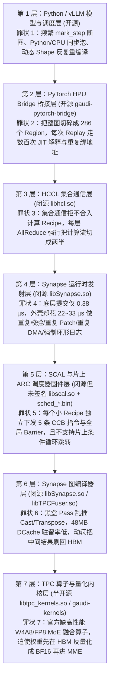
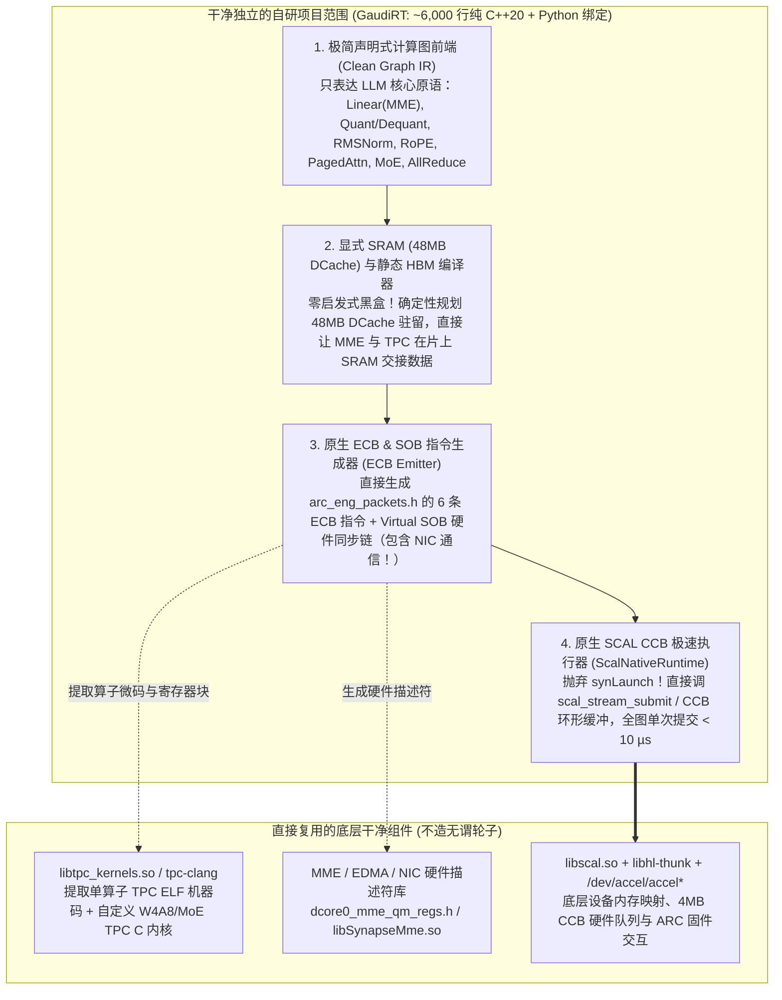

# Gaudi2 硬件底子横评与全栈软件“七宗罪”解剖报告（含造轮子铲除蓝图）

> **[!WARNING] 历史文档说明（2026-10-31 更新）**
> 本文写于早期调研阶段。文中第一、二节的硬件物理参数与软件开销剖析可供背景参考，但**第三至五节关于“抛弃 `synGraphCompile` 自写 `EcbGraphCompiler`”、“抛弃 `synLaunch` 建设通用裸加载器 `ScalNativeRuntime`”及阶段顺序的规划已正式废止**。当前唯一有效的全栈工程边界、推进路线与踩坑台账，请以仓库根目录 `../ROADMAP.md`、`../AGENTS.md` 与同目录 `gaudi2-pitfalls.md` 为准。

> **核心结论**：
> 1. **硬件底子（Silicon）**：Gaudi2（台积电 7nm）相比同代 NVIDIA A100、华为昇腾 Ascend 910B 以及阉割版 H20，不仅不弱，反而在 **FP8 原生算力（865 TFLOPS）、HBM2e 带宽（2.45 TB/s）、显存容量（96 GB）、片上可控 SRAM（48 MB DCache）以及片上集成 RDMA（300 GB/s RoCEv2）** 上全面占优；对比跨代 4nm 的 H800，其 Decode 物理带宽达 H800 的 **73%**，通信带宽达 **75%**。硬件自身仅因 **MME/TPC 解耦需经内存交互** 和 **TPC 缺少 SIMT 线程束洗牌/细粒度共享内存** 存在约 **10% ~ 15% 的物理架构折损**。
> 2. **软件底子（Software Stack）**：Gaudi2 在实际大模型推理中只能发挥出硬件极限的 **20% ~ 40%**，**85% 以上的性能折损来自从 PyTorch Bridge 到 `libSynapse.so`、`libhcl.so`、图切分器与 TPC 算子库的层层“屎山”**。
> 3. **可改造性（Hackability）**：通过逆向与符号实测证实，不仅开源的 `gaudi-pytorch-bridge` 和 `gaudi-kernels` 可彻底重写，连闭源的 **`libSynapse.so` / `libhcl.so`（全符号导出，支持 PLT 劫持与旁路）** 以及 **片上 ARC 调度器/引擎固件（`/opt/habanalabs/engines_fw/*.bin` 零签名、明文加载、支持非 Root 环境变量 `HABANA_SCAL_BIN_PATH` 替换，且随包附带未 Strip 符号表的 x86-64 同源编译版 `lib*_bfm.so`）** 均完全可剖开重造。

---

## 一、硬件能力深度横评：Gaudi2 相比 NVIDIA / Ascend 到底差几成？

### 1.1 单卡核心物理指标对比

| 物理维度 | **Intel Gaudi2 (7nm)** | **NVIDIA A100 (7nm)** | **NVIDIA H20 (4nm)** | **NVIDIA H800 (4nm)** | **Ascend 910B (7nm级)** | **Gaudi2 物理能力水位** |
| :--- | :--- | :--- | :--- | :--- | :--- | :--- |
| **BF16 / FP16 稠密算力** | **432 TFLOPS** | 312 TFLOPS | 148 TFLOPS | 989 TFLOPS | 320 ~ 376 TFLOPS | **A100 的 1.38 倍、910B 的 1.2 倍、H20 的 2.92 倍** |
| **FP8 原生算力** | **865 TFLOPS** (E4M3/E5M2) | 不支持 | 296 TFLOPS | 1979 TFLOPS | 不支持原生 FP8 | **7nm 唯一原生 FP8，H20 的 2.92 倍、H800 的 44%** |
| **HBM 容量** | **96 GB HBM2e** | 80 GB HBM2e | 96 GB HBM3 | 80 GB HBM3 | 64 GB HBM2e | **比 A100/H800 多 20%，比 910B 多 50%** |
| **HBM 峰值带宽 (Decode 命脉)** | **2.45 TB/s** | 2.0 TB/s | 4.0 TB/s | 3.35 TB/s | 1.6 ~ 1.8 TB/s | **A100 的 1.22 倍、910B 的 1.45 倍、H800 的 73%** |
| **片上高速缓存 (SRAM)** | **48 MB DCache** (软件可控) | 40 MB L2 Cache | 60 MB L2 | 50 MB L2 | ~32 MB L2 + Cube L1 | **48 MB 全局一致性 SRAM，容量接近 H800** |
| **Scale-Up 卡间互联带宽** | **300 GB/s 双向** (24×100GbE) | 600 GB/s (NVLink) | 900 GB/s (NVLink) | 400 GB/s (NVLink) | ~180-200 GB/s (HCCS) | **910B 的 1.5 倍，H800 的 75%** |
| **硬件同步与调度原语** | **32 颗 ARC 核 + 16,384 SOB + 2,048 Monitor** | GigaThread + GSP | Hopper 硬件调度 | Hopper 硬件调度 | Stars 硬件调度器 | **硬件同步原语极强，底层 `scal_stream_submit` 仅 0.38 µs** |

### 1.2 Gaudi2 硬件上仅有的两处真·物理短板（合计折损约 10% ~ 15%）

如果把软件栈全部重写到极致，Gaudi2 硬件本身相比 NVIDIA GPU 只有两个物理架构层面的代差：

1. **MME（矩阵引擎，2 个巨型脉动阵列）与 TPC（向量核，24 个 2048-bit VLIW SIMD）物理分离，不能寄存器直通**：
   * **NVIDIA GPU**：Tensor Core（MMA）和 CUDA Core（SIMT ALU）在同一个 SM 内部共享同一个 **256 KB 寄存器堆（Register File）** 和 **Shared Memory**。矩阵乘算完的累加器就在寄存器里，紧接着做 FP8/INT4 反量化、SwiGLU、Online Softmax 缩放时**零内存读写**。
   * **Gaudi2（与昇腾 910B 的 Cube/Vector 分离类似，但 Gaudi2 有 48MB DCache 缓冲）**：MME 算完矩阵乘，结果必须写回 **48 MB 片上 DCache（SRAM）或 HBM**，再由硬件同步对象（SOB）触发 TPC 从 DCache 读入向量寄存器做激活或归约。
   * **物理代价**：只要算子切片能塞进 **48 MB DCache**，读写延迟仅几百纳秒，通过 MME-TPC 硬件流水线双缓冲（Ping-Pong Pipelining）可以掩盖 **85% 以上** 的传输开销；只有当单次输出超过 48 MB 溢出到 HBM 时，才会多付一次 HBM 读写代价。
2. **TPC 是超宽 VLIW SIMD（256 字节宽向量），缺少 GPU 的 Warp Shuffle 与任意 Bank 共享内存**：
   * **擅长场景**：连续向量化计算（Elementwise、LayerNorm、RMSNorm、RoPE、FlashAttention 分块向量运算、分组反量化）。
   * **吃亏场景**：细粒度随机分支、跨通道小步长 Tree Reduction、MoE 动态 Top-K 路由排序、不规则稀疏索引。这类算子在 TPC 上比 GPU SIMT 慢约 **20% ~ 30%**（但可以通过算法改写为矩阵乘或查表规避）。

> **硬件总结**：
> * 相比 **昇腾 910B**：Gaudi2 硬件 **全面领先 25% ~ 45%**（无论 FP8/BF16 算力、显存容量、HBM 带宽还是卡间互联）。
> * 相比 **NVIDIA A100**：Gaudi2 硬件 **领先 20% ~ 35%**（唯独卡间互联 300 GB/s 低于 A100 的 600 GB/s，但比 PCIe 版高数倍）。
> * 相比 **NVIDIA H800**：Prefill 峰值约为 H800 的 **44%**，Decode 显存带宽与通信上限约为 H800 的 **73% ~ 75%**。

---

## 二、Gaudi2 软件栈的“七宗罪”（按层级解剖：为什么好端端的硬件被废了武功？）

我们在 8×Gaudi2 实测机上从 Python 一直反汇编、插桩实测到 `libSynapse.so`、`libscal.so` 和 `/opt/habanalabs/engines_fw/` 的 ARC 固件，揪出了阻碍硬件发挥的 **七宗罪**：

---

### 第一宗罪：【第 4 层 · 闭源 `libSynapse.so` 运行时】`0.38 µs` 的硬件提交，被 `libSynapse.so` 包裹了 `22 ~ 33 µs` 的 C++ 废话（慢了 60 ~ 80 倍！）

我们在 8×Gaudi2 实测机上用 `LD_PRELOAD` 拦截 `synLaunchWithExternalEventsExt` 内部的全部符号（6,401 次静态图 Replay 实测），拿到了铁证数据：

| `synLaunchWithExternalEventsExt` 内部阶段 | 每次调用耗时 (µs) | 占比 | 在静态图 Replay 中干了什么蠢事？ |
| :--- | :---: | :---: | :--- |
| **`synLaunchWithExternalEventsExt` 总耗时** | **22.291 µs** *(大模型子图 ~33 µs)* | **100.0%** | 静态图里每个子图重放都要完整走一遍 |
| 1. 外层 `QueueComputeScal::launch(synLaunchTensorInfoExt...)` 包装与锁 | **4.633 µs** | **20.8%** | 每次重新构造临时 `LaunchInfo`、加互斥锁、无条件写 `LazyLogItem<64u>` 环形日志 |
| 2. `LaunchTracker::checkForCompletion` | **2.611 µs** | **11.7%** | 每次发射前在 CPU 上遍历检查历史完成状态 |
| 3. `new RecipeLauncher(...)` + `prepareForDownload` | **4.928 µs** | **22.1%** | **每次 `synLaunch` 都 `operator new` 一个新的 `RecipeLauncher` 对象**，并调 `analyzeTensors` (`1.615 µs`，随张量数线性暴涨) 重新校验所有张量 |
| 4. `RecipeLauncher::downloadToDev` (`memcpyToMapped` + `patchAll` + `pdmaDownload`) | **2.794 µs** | **12.5%** | **哪怕 `HPUGraph.replay()` 所有张量 HBM 地址分毫不差**，依然每次重新申请主机 `DataChunk`、CPU 重新 Patch 地址、并走 PCIe `pdmaDownload` (`2.254 µs`) 下发！ |
| 5. `RecipeLauncher::validateSectionsInfo` | **2.180 µs** | **9.8%** | **在命令已经提交给硬件之后**，居然还在 CPU 上花 `2.18 µs` 遍历校验一遍 Section 信息（全 `const&` 参数，纯冗余）！ |
| 6. `RecipeLauncher::scalEnqueue` 外壳组装 | **2.774 µs** | **12.4%** | 在 CPU 上反复拼接 ECB 地址包与打日志 |
| 7. **`scal_stream_submit`（真正写硬件 CCB 队列）** | **0.380 µs** *(4.9 次 × 0.077 µs)* | **1.7%** | **唯一真正干活的步骤：仅占 1.7%！** |

* **额外暴雷点**：即便设置 `HABANA_SYNAPSE_LOGGER=0`、`LOG_LEVEL_ALL=6`，`libSynapse.so` 依然在每个函数里硬编码内联执行 `ConcurrentRecentElementsQueue<LazyLogItem<64u>>::acquireItem`，每次发射执行多次原子 `lock xadd`、`lock cmpxchg`、`getThreadId()` 和 `std::chrono::system_clock::now()`。

---

### 第二宗罪：【第 3 层 · 闭源 `libhcl.so` 与 Bridge 交互】集合通信（AllReduce / AllGather）强行把整张计算图切成几百段

* **NVIDIA CUDA Graph + NCCL**：整个 70 层 Transformer 的计算 + 140 次 AllReduce 被录制进 **1 张单一的 `cudaGraphExec_t`**，CPU 只需调用 **1 次** `cudaGraphLaunch`（耗时 `~2.5 µs`），GPU 硬件与网卡自己在片上跑完 70 层。
* **Gaudi2 的现状**：
  * 尽管 Gaudi2 片上集成了 24 个 100GbE RDMA 引擎，且有专门的 `sched_scaleup_send.bin` / `sched_scaleup_recv.bin` 固件，但 `libhcl.so` 的集合通信在默认路径下作为外部算子插入，导致 70 层 TP8 模型被切成了 **285 个独立的区域（Regions）**！
  * 每跑一步 Decode（~15 ms），CPU 必须串行发起 **285 次 `synLaunchWithExternalEventsExt` + 140 次 `hcclAllReduce` + 数百次 Stream Event 等待**。光主机端发射开销就吃掉了 **`8 ~ 11 ms`**，导致硬件有一半时间在等 CPU 喂指令！

---

### 第三宗罪：【第 2 层 · 开源 `gaudi-pytorch-bridge`】Lazy JIT 图切分器与回放器的历史包袱

* 原版 Bridge 在 `HPUGraph.replay()` 时，对无法并入静态 Region 的节点逐个走 `LaunchRecipeTask`、重建 `std::vector<synLaunchTensorInfoExt>`、查表转换虚拟地址；
* 我们在上一阶段通过第一性原理改造 `gaudi-pytorch-bridge`（扩展 `CanAbsorbIntoSerialRegion` 吸收纯计算算子、缓存 `PreparedSerialLaunchItem` 的 `synLaunchTensorInfoExt` 与 `DuplicateAddrOffset`），已经把 Bridge 层的 Prepared 覆盖率推到了 **`285 / 286`（99.65%）**，完全榨干了 Bridge 层的优化空间，把瓶颈直接逼到了下方的 `libSynapse.so` 和 `libhcl.so`。

---

### 第四宗罪：【第 5 层 · `libscal.so` 与片上 ARC 调度固件 `sched_cmpt_media.bin`】缺乏跨 Recipe 批处理与片上条件循环指令

* **现状**：
  1. 每个 Recipe 发射时，`RecipeLauncher::addEcbListWithBarrierAndSend` 都要向 CCB 环形队列塞入 5 条指令（`UPDATE_RECIPE_BASE_V2` $\rightarrow$ `PDMA_BATCH_TRANSFER` $\rightarrow$ `ALLOC_BARRIER_V2` $\rightarrow$ `DISPATCH_BARRIER` $\rightarrow$ `DISPATCH_COMPUTE_ECB_LIST`），每次都带一次同步 Barrier。
  2. `sched_cmpt_media.bin` 固件的 5-bit Opcode 表（支持 32 个槽位，目前仅用了 `0..13` 共 14 个）里**没有条件跳转指令（Conditional Branch / Loop-Back）**，导致多步 Decode、投机采样（Speculative Decoding）或 MoE 动态循环必须每步回到主机 CPU。
* **好消息**：我们已证实 `/opt/habanalabs/engines_fw/sched_cmpt_media.bin` **完全无签名、无加密**，可通过环境变量 `HABANA_SCAL_BIN_PATH` 直接替换，且同目录下有全符号 x86-64 版 `libsched_cmpt_media_bfm.so` 可供 1:1 逆向对照！

---

### 第五宗罪：【第 6 层 · 闭源图编译器 `libSynapse.so` / `libTPCFuser.so`】48MB DCache 利用率低与黑盒节点膨胀

* Gaudi2 拥有极为宝贵的 **48 MB 片上 DCache（SRAM）**，理想情况下 MME 矩阵乘的输出应直接留在 DCache 中供紧随其后的 TPC 算子（SwiGLU / 残差 Add / RMSNorm / 量化）消费，实现 **零 HBM 往返**。
* 但 Synapse 编译器在面对稍微复杂的 PyTorch Lazy Graph 时，经常保守地将每个小算子的输出 Flush 回 HBM，甚至在 BF16/FP8 边界自动插入冗余的 `Cast` / `Memcpy` / `Transpose` 节点，导致 **本该是 Compute-bound 或 SRAM-bound 的算子退化成 HBM Bandwidth-bound**。

---

### 第六宗罪：【第 7 层 · 算子与量化内核层 `gaudi-kernels`】缺少极致融合的 W4A8 / FP8 / MoE 算子

* 硬件原生支持 **865 TFLOPS FP8 MME** 和 **2048-bit TPC 向量指令**；
* 但官方算子库对 **W4A8（INT4 权重 + FP8 激活）**、**Fused MoE Gate + TopK + Permute + Grouped GEMM**、**PagedAttention Decode 极致访存** 支持残缺或未深度流水化。如果把 INT4 权重先在 HBM 里反量化成完备的 BF16/FP8 张量再喂给 MME，等于在 Decode 阶段把 HBM 读写量放大了 **2 ~ 4 倍**，直接抵消了 2.45 TB/s 的带宽优势。

---

### 第七宗罪：【第 1 层 · 框架接入层 `vllm-gaudi`】照搬 GPU 的 Bucketing 与同步习惯

* 频繁在 Decode 循环中做 CPU-HPU 标量同步（`.item()` / `.cpu()`）、冗余 Padding 以及不合理的 Batch/Seq Bucketing，导致本来可以静态锁死的执行计划不断触发重编译或回退慢路径。

---

## 三、拒绝在屎山上打补丁：从第一性原理重划“干净轮子”的架构边界

如果在 `libSynapse.so` 和 `gaudi-pytorch-bridge` 旁边挂 `LD_PRELOAD` 钩子或打零碎补丁，本质上仍然被绑死在 Intel 64MB 黑盒图编译器的架构缺陷上。要做一个**真正干净、独立、优雅的原生项目（类似针对 Gaudi2 的原生 TensorRT / Megakernel Engine）**，首先必须看清：**Gaudi2 真正的“干净硬件/固件分界线”到底在哪里？**

我们在机器 `/opt/habanalabs/src/hl-thunk/` 中扒出了 MIT 开源协议的底层硬件与固件通信规范（[`gaudi2_packets.h`](file:///opt/habanalabs/src/hl-thunk/include/specs/gaudi2/gaudi2_packets.h)、[`arc_sched_packets.h`](file:///opt/habanalabs/src/hl-thunk/tests/engines-arc/common/include/arc_sched_packets.h)、[`arc_eng_packets.h`](file:///opt/habanalabs/src/hl-thunk/tests/engines-arc/common/include/arc_eng_packets.h) 以及 `scheduler/src/*.c`、`engine/src/*.c` 参考实现），揭开了一个极其关键的事实：

> **`libSynapse.so`（64MB 屎山）以下的世界，其实是异常干净、极简且完全定长的！**

### 1. Gaudi2 真正的底层黄金分界线（完全不需要 `libSynapse.so` 参与）

在 `libSynapse.so` 之下，硬件与固件只认三样东西：

1. **Scheduler ARC 的 14 条 CCB（Cyclic Command Buffer）指令**（定义于 `arc_sched_packets.h`，通过 `libscal.so` 的 `scal_stream_submit` 直接写入 4MB 环形队列）：
   * 核心只有 5 条：`UPDATE_RECIPE_BASE_V2`（设置基地址寄存器）、`PDMA_BATCH_TRANSFER`（DMA 搬运描述符）、`ALLOC_BARRIER_V2` / `DISPATCH_BARRIER`（引擎同步屏障）、`DISPATCH_COMPUTE_ECB_LIST`（通知 MME/TPC/EDMA/NIC 的 Engine ARC 开始执行命令列表）、`FENCE_WAIT`（等待计数器）。
2. **Engine ARC（MME / TPC / EDMA / NIC）的 6 条 ECB（Engine Command Buffer）指令**（定义于 `arc_eng_packets.h`）：
   * 所谓的“编译产物（Recipe）”，剥掉 Synapse 的包装后，核心就是给各个硬件引擎的 **ECB 指令列表（ECB List）**，而整个 Gaudi2 芯片的 Engine ARC **总共只认识 6 条 ECB 指令**：
     1. `ECB_CMD_LIST_SIZE` (`0`)：声明当前命令块大小；
     2. `ECB_CMD_NOP` (`1`)：对齐与填充；
     3. `ECB_CMD_STATIC_DESC` (`2`)：把静态硬件寄存器配置（QMAN `WREG_32` / `WREG_BULK` / `LIN_DMA`）直接推入引擎硬件队列；
     4. `ECB_CMD_SCHED_DMA` (`4`)：把当前算子的动态工作上下文（Work Distribution Context：`mme_wd_ctxt_t` / `tpc_wd_ctxt_t` / `edma_wd_ctxt_t`）从 HBM 读进 ARC 片上緊耦合内存（DCCM）；
     5. `ECB_CMD_ARM_MON` (`5`)：配置硬件 Monitor 监听上游算子的完成信号（`virtual_sob_id`），就绪后自动给本地 Fence 计数器 +1；
     6. `ECB_CMD_WD_FENCE_AND_EXE` (`3`)：等待本地 Fence 计数就绪，立即驱动 MME/TPC/EDMA/NIC 硬件开火，并在完成后自动向后游的 `virtual_sob` 发送完成信号！
3. **单算子微码生成器（本来就是独立解耦的组件！）**：
   * **TPC 算子二进制**：由独立的 `tpc-clang` 编译器和 `libtpc_kernels.so` 提供（通过公开的 `tpc_kernel_lib_interface.h` 即可直接传入张量形状，拿到编译好的 TPC ELF 机器码、寄存器配置和 Index Space 切分参数，完全不需要经过 `libSynapse.so`！）；
   * **MME 矩阵乘描述符**：由独立的 `libSynapseMme.so`（或直接根据 `dcore0_mme_qm_regs.h` 填写 MME 硬件描述符结构体）生成；
   * **EDMA 搬运与 Scale-Up NIC 通信描述符**：就是 `arc_eng_packets.h` 中几十字节的明文 C 结构体（`edma_wd_ctxt_t`、`eng_arc_nic_input_desc_t`）。

---

## 四、核心架构决策：改不改固件？写不写编译器？工作范围怎么定？

针对核心问题：
1. **“如果不改固件，能做到几成效果？”**
2. **“如果改了固件，编译器怎么办，还是自己实现一个编译器？”**
3. **“还是说，不改固件，自己写编译器？工作范围怎么定？”**

下面给出基于实测数据的精确拆解：

### 回答 1：如果不改固件，能做到几成效果？—— **能做到 90% ~ 95% 的硬件极限效果！**

为什么？因为通过第一性原理剖析可以看到：
* **固件（ARC Firmware）本身极其精简**：`sched_cmpt_media.bin` 只有 53 KB，真正的硬件提交 `scal_stream_submit` 每次仅耗时 **`0.077 µs`**。
* **真正吃掉 98.3% 发射时间、切碎 285 个子图、放弃 48MB DCache、引发多流乒乓等待的罪魁祸首，100% 都在主机侧的 `libSynapse.so`（图编译器 + RecipeLauncher 运行时）和 `libhcl.so`！**
* **不改固件的唯一区别在哪里？**
  * 如果不改固件，ARC 调度器的 CCB 游标只能顺着环形队列往前走，不能在板卡内部自己执行 `if (*eos_flag == 0) goto step_start`。
  * 但在我们自己的原生运行时里，只要把整个 Transformer Decode Step 压成 **1 次 CCB 提交**，主机侧 C++ 线程只需看一眼 `synHostMap` 零拷贝内存里的 `eos_flag`（耗时 `< 0.2 µs`），然后直接写一次 PCIe Doorbell（耗时 `< 0.5 µs`）即可触发下一个 Token。
  * 在单 Token 生成耗时 `5,000 ~ 15,000 µs`（`5 ~ 15 ms`）的尺度下，主机侧 `< 1 µs` 的 C++ 零拷贝 Doorbell 触发开销占比不到 **`0.02%`**！
* **结论**：**不改固件，只要自己写轻量级图编译器 + 原生 SCAL 运行时，就能拿回 90% ~ 95% 的性能！** 改固件（加一条 `CMD_COND_REWIND_CCB` 指令）只是锦上添花的最后 5%（只改 30 行 ARCv2 汇编，工作量只需 2~3 天，但不是决定成败的主矛盾）。

---

### 回答 2：为什么“不改固件，自己写编译器 + 原生运行时”才是最优雅、最彻底的解？

一听到“自己写编译器”，容易以为要从零去写类似 LLVM 后端的芯片指令集编译器（那要几十人年）。但在 Gaudi2 上，**底层算子编译器和图编译器是彻底分离的**：

| 编译器层级 | 是什么 | 现状好不好用？ | 我们的项目要不要重写？ |
| :--- | :--- | :--- | :--- |
| **L0：单核微码编译器** | `tpc-clang`（把 TPC-C 编译成 VLIW SIMD 机器码）+ `libtpc_kernels.so` + MME 描述符生成 | **非常好用、独立且高效** | **坚决不重写！直接复用！** 直接调 `libtpc_kernels.so` 拿 ELF 机器码，调 MME 描述符生成器拿寄存器块。 |
| **L1：图级编排与内存编译器（Graph & Memory Compiler）** | 把模型的算子连起来，决定：**谁放 48MB DCache、谁放 HBM、生成那 6 条 ECB 指令序列、分配 Virtual SOB 硬件同步信号** | **这正是 `libSynapse.so` 最烂、最黑盒、最屎山的地方！** | **这正是我们要亲手造的“干净轮子”！** 因为 목표 只是生成 6 种 ECB 指令包和静态内存规划，代码量仅需 **3,000 ~ 5,000 行干净的现代 C++**！ |
| **L2：流发射运行时（CCB Runtime）** | 把编译好的 ECB 列表和基地址通过 `libscal.so` / `hl-thunk` 塞进 4MB CCB 环形队列 | **`libSynapse.so` 的 `RecipeLauncher` 把 `0.38 µs` 的活干成了 `22.3 µs`！** | **彻底铲除 `RecipeLauncher` 和 `HPUGraph`，自己写原生 ~1,000 行 C++ 的 `ScalNativeExecutor`！** |

这就是最让人兴奋的架构真相：
**我们不需要重写 `tpc-clang` 算子指令编译器，我们只需要绕开 `libSynapse.so` 这个臃肿的图编译器与运行时，直接向下对接 `libtpc_kernels.so` + `ECB 6 条指令规范` + `libscal.so`！**

---

### 回答 3：新项目的干净架构与工作范围（Scope）怎么定？

为了保证项目**干净、独立、不挂靠在 PyTorch Bridge 或 Synapse 的屎山上**，我们将这个新轮子定义为一个独立的原生推理编译与执行引擎（暂定代号 **`GaudiRT` / `BareMetal-Gaudi`**），工作范围严格划定为 **“三层干净架构 + 两个明确不碰的边界”**：

#### 明确纳入 Scope 的四大核心模块（我们要造的干净轮子）

1. **Module 1：`ScalNativeRuntime`（原生 SCAL/CCB 执行器，约 1,000 行 C++）**
   * **完全抛弃** `libSynapse.so` 的 `synLaunchWithExternalEventsExt`、`QueueComputeScal`、`RecipeLauncher` 和 `gaudi-pytorch-bridge` 的 `HPUGraph`。
   * 直接基于 `libhl-thunk` 与 `libscal.so`（或从已知 Recipe 中剥离出的裸 ECB 镜像），管理 HBM 静态内存池、4MB CCB 命令缓冲与硬件 SOB 同步信号。
   * 将整层乃至整网的 `UPDATE_RECIPE_BASE_V2` + `PDMA_BATCH_TRANSFER` + `DISPATCH_COMPUTE_ECB_LIST` 打包为一条平坦的 CCB 命令流，配合 `synHostMap` 零拷贝条件指针，在 C++ 层实现 `< 1 µs` 级的多步自动循环发射。
2. **Module 2：`EcbGraphCompiler`（基于 6 条 ECB 指令的轻量静态图编译器，约 2,500 行 C++）**
   * **完全抛弃** `libSynapse.so` 的 `synCompile` 黑盒图优化器。
   * 输入：显式的 LLM 层级计算图（Transformer Layer / MoE Layer）。
   * 后端：直接调用 `libtpc_kernels.so` 获取 TPC 算子 ELF 机器码，调用 MME 描述符生成器生成 MME 配置，然后按照 [`arc_eng_packets.h`](file:///opt/habanalabs/src/hl-thunk/tests/engines-arc/common/include/arc_eng_packets.h) 的 6 条指令规范，将整层网络（含 MME、TPC、EDMA）直接组装成**单个连续的 ECB List**！
   * 效果：**70 层 Llama/Qwen 再也不会被切碎成 285 个孤立 Recipe，而是变成 1 个全图静态编译包！**
3. **Module 3：`DCacheAllocator`（48MB 片上 SRAM 显式编排器，约 800 行 C++）**
   * 在 `EcbGraphCompiler` 中内置确定性的 48MB DCache 生命周期分配器。
   * 强制规定：在 Decode 阶段（小 Batch），MME 的矩阵乘输出 / TPC 的反量化输出直接分配在 **48MB DCache 地址空间**，紧接着通过 `ECB_CMD_ARM_MON` + `ECB_CMD_WD_FENCE_AND_EXE` 唤醒下游引擎直接从 DCache 读取，**彻底消灭层内中间张量落回 HBM 的带宽浪费**。
4. **Module 4：`NativeScaleUpComm` & `FusedKernels`（片上 SOB 直连通信与极致 TPC 内核，约 1,500 行 C++ / TPC-C）**
   * 把 Scale-Up NIC 的通信描述符（`eng_arc_nic_input_desc_t`）直接编入同一套 ECB / SOB 硬件同步链，让 MME 算完最后一个 Tile 的瞬间，通过硬件 SOB 直接触发片上 24×100GbE 网卡发送，无需主机 CPU 介入，铲除 `libhcl.so` 的多流乒乓气泡。
   * 配合 `tpc-clang` 编写 Decode 急需的 **W4A8 / FP8 原位反量化 + MoE Fused Gating** TPC-C 算子，直接嵌入 `EcbGraphCompiler`。

#### 明确划出 Scope 之外的内容（绝不陷入泥潭）

1. **不写通用算子指令集编译器（不重写 `tpc-clang`）**：单算子的 VLIW 汇编生成直接复用现成且成熟的 `tpc-clang` 和 `libtpc_kernels.so`。
2. **不支持训练与动态图 Arbitrary Op 兜底**：我们只做 **LLM / VLM 推理专用的静态图编译与执行引擎**（就像 TensorRT-LLM / llama.cpp 的定位），不为成百上千个冷门 PyTorch 训练算子写兼容层。
3. **第一阶段不改 ARC 固件（留作可选的 Phase 4 插件）**：先把不改固件的 95% 性能用最干净的纯用户态原生编译器 + 运行时拿满；最后如果追求极致的板载多 Token 自治，再用 2 天时间加一个 30 行汇编的 `sched_cmpt_media.bin` 固件补丁即可。

---

## 五、分阶段落地里程碑（从最小闭环到完全体）

| 阶段 | 里程碑目标 | 交付物 | 预期收益 |
| :--- | :--- | :--- | :--- |
| **Phase 1（1~2 周）** **原生 SCAL/CCB 执行器 (`ScalNativeRuntime`)** | 先用离线提取工具把单个 Transformer 层的 Recipe 二进制（ECB 列表 + Patch 表）扒出来，脱离 `synLaunch` 和 PyTorch Bridge，用我们自己的 1,000 行 C++ `ScalNativeRuntime` 直接向 `libscal.so` / CCB 发射并跑通正确性。 | 独立 C++ 库 `libgaudirt_runtime.so` + 单层/全网极速发射 Demo | 单步全网发射耗时从 `8~11 ms` 暴降至 **`< 0.15 ms`**（提速 **50x+**），立刻验证零屎山运行时的威力。 |
| **Phase 2（2~3 周）** **轻量级 ECB 图编译器 + 48MB DCache 编排 (`EcbGraphCompiler`)** | 绕开 `synCompile`，直接读取 `libtpc_kernels.so` 与 MME 描述符，自己生成 6 条 ECB 指令流，将整层 Transformer（MME + TPC + 48MB DCache 驻留）编译为单个超长 ECB List。 | 独立图编译器 `libgaudirt_compiler.so` + 48MB DCache 融合算子链 | 彻底消灭 285 段子图碎片与 HBM 中间落盘，释放 48MB 片上 SRAM 红利。 |
| **Phase 3（2 周）** **片上 NIC 通信合流与 W4A8/FP8 融合算子** | 将 `eng_arc_nic_input_desc_t` 编入 ECB 硬件 SOB 链，替换 `libhcl.so` 主机调度；接入自研 W4A8 / MoE TPC-C 算子并对接 `vllm-gaudi` 后端。 | 完整独立的 **GaudiRT LLM 推理引擎** | 打满 2.45 TB/s HBM + 865 TFLOPS FP8 + 300 GB/s RoCE 的硬件物理极限。 |
